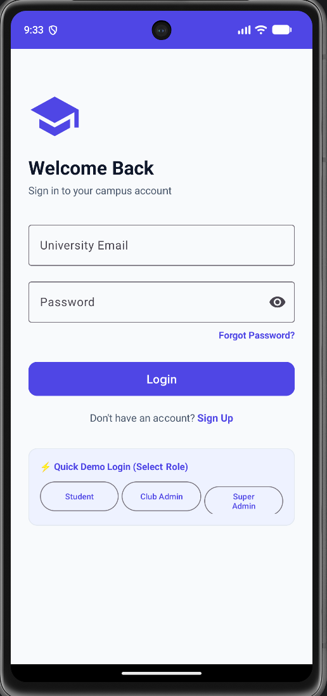
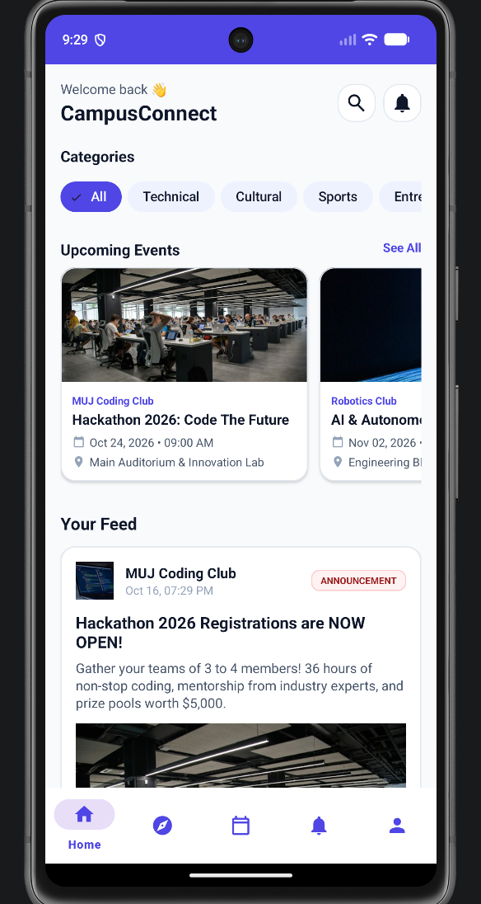
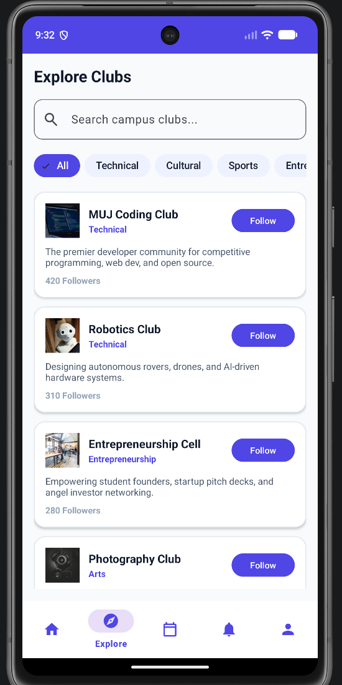
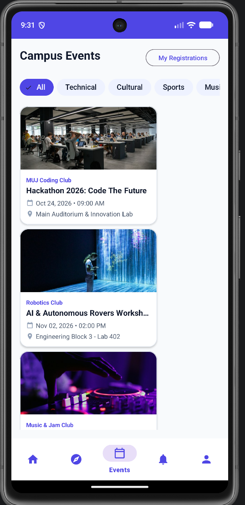
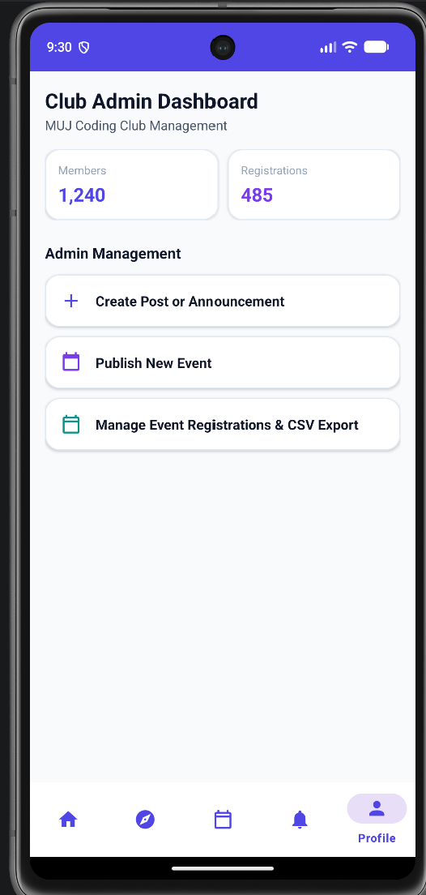
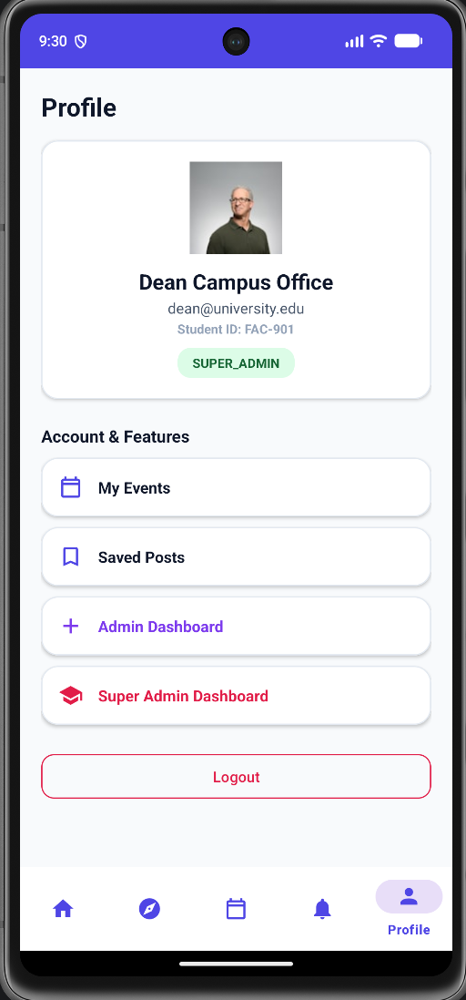

# 📱 CampusConnect — University Club & Community Hub

[](https://developer.android.com/)
[](https://kotlinlang.org/)
[](https://m3.material.io/)
[](#-architecture)
[](LICENSE)

**CampusConnect** is a modern native Android application designed for university communities. It connects students, club leaders, and campus administrators through a unified digital platform.

Built using **Kotlin, MVVM Architecture, Material Design 3, and Firebase**, CampusConnect provides club discovery, campus announcements, event registration, user profiles, and administrative tools. The application also includes an offline/demo mode powered by mock data, allowing users to explore its functionality without configuring a live Firebase backend.

---

## 📸 Screenshots

### Application Screens

| Splash & Login | Home Feed | Club Discovery |
|:---:|:---:|:---:|
|  |  |  |

| Event Details | Admin Dashboard | User Profile |
|:---:|:---:|:---:|
|  |  |  |

---

## 🌟 Key Features

### 🎓 Student Features

- **Club Discovery:** Explore university clubs across technical, cultural, sports, arts, and entrepreneurship categories.
- **Interactive Home Feed:** View club updates, announcements, and posts.
- **Post Interactions:** Like, comment on, and save posts.
- **Event Management:** Discover upcoming workshops, hackathons, and campus events.
- **Event Registration:** Register for events and view registration information.
- **Passes and Bookmarks:** Access registered events and saved content through the profile section.
- **Notifications:** Receive feedback about registrations and application interactions.

### 🛡️ Club Admin Features

- **Announcements and Posts:** Publish club updates and official announcements.
- **Event Creation:** Configure event titles, descriptions, dates, venues, deadlines, and seat capacities.
- **Attendee Tracking:** View student registration information.
- **CSV Export:** Export attendee information to CSV format.

### 👑 Super Admin Features

- **Role Management:** Manage `STUDENT`, `CLUB_ADMIN`, and `SUPER_ADMIN` privileges.
- **Campus Moderation:** Support content oversight and club verification workflows.

---

## ⚡ Demo Mode

CampusConnect includes a demo switcher on the login screen so users can explore different application roles without configuring Firebase.

| Role | Demo Email | Password | Access |
|---|---|---|---|
| Student | `student@muj.manipal.edu` | `password123` | Feed, clubs, event registration, saved posts |
| Club Admin | `admin@codingclub.com` | `password123` | Student features, post creation, event management, attendee export |
| Super Admin | `super@campusconnect.com` | `password123` | Role management and administrative features |

> **Note:** These are demo credentials for the built-in mock-data mode. When `google-services.json` is absent, the application can use its offline/demo data engine instead of live Firebase services.

---

## 🏗️ Architecture

CampusConnect follows the **Model-View-ViewModel (MVVM)** architectural pattern and uses the Repository Pattern to separate the user interface from data access.

```text
┌───────────────────────────────────────────────────────────┐
│                        View Layer                         │
│          Activities, Fragments, XML, ViewBinding          │
└─────────────────────────────┬─────────────────────────────┘
                              │ Observes UI state
┌─────────────────────────────▼─────────────────────────────┐
│                     ViewModel Layer                       │
│               Authentication and UI logic                  │
└─────────────────────────────┬─────────────────────────────┘
                              │ Requests data
┌─────────────────────────────▼─────────────────────────────┐
│                     Repository Layer                      │
│              Authentication and campus data               │
└────────────────┬──────────────────────────┬───────────────┘
                 │                          │
┌────────────────▼────────────┐ ┌───────────▼───────────────┐
│       Firebase Services     │ │      Offline Fallback     │
│   Auth, Firestore, Storage  │ │    SampleDataGenerator    │
└─────────────────────────────┘ └───────────────────────────┘
```

### Architectural Highlights

- **Separation of Concerns:** UI components, application logic, and data access are organized into separate layers.
- **ViewBinding:** Provides type-safe access to views in XML layouts.
- **Repository Pattern:** Centralizes data access and supports different data sources.
- **Resource Wrapper:** Represents loading, success, and error states using `Resource<T>`.
- **Navigation Components:** Supports navigation between application screens.
- **Offline/Demo Support:** Allows the application to run with sample data when Firebase configuration is unavailable.

---

## 🛠️ Technology Stack

| Category | Technology | Purpose |
|---|---|---|
| Language | Kotlin 1.9.22 | Primary application language |
| UI | XML Layouts | Application screen layouts |
| Design System | Material Design 3 | UI components and theming |
| Architecture | MVVM | Separation of UI and business logic |
| Android Components | Android Jetpack | ViewModel, LiveData, Lifecycle |
| Navigation | AndroidX Navigation | Screen navigation |
| Concurrency | Kotlin Coroutines | Asynchronous operations |
| Image Loading | Glide 4.16.0 | Image loading and caching |
| Backend Integration | Firebase | Authentication and cloud data services |
| Local/Demo Data | SampleDataGenerator | Offline demonstration data |
| Build System | Gradle Kotlin DSL | Dependency management and builds |

---

## 📁 Project Structure

```text
CampusConnect/
├── app/
│   ├── build.gradle.kts
│   └── src/
│       └── main/
│           ├── AndroidManifest.xml
│           ├── java/com/campusconnect/app/
│           │   ├── CampusConnectApp.kt
│           │   ├── adapter/
│           │   ├── data/
│           │   │   ├── model/
│           │   │   └── repository/
│           │   ├── ui/
│           │   │   ├── MainActivity.kt
│           │   │   ├── admin/
│           │   │   ├── auth/
│           │   │   ├── events/
│           │   │   ├── explore/
│           │   │   ├── home/
│           │   │   ├── notifications/
│           │   │   ├── posts/
│           │   │   ├── profile/
│           │   │   └── superadmin/
│           │   ├── utils/
│           │   └── viewmodel/
│           └── res/
│               ├── drawable/
│               ├── layout/
│               ├── menu/
│               ├── navigation/
│               └── values/
├── gradle/
├── screenshots/
│   ├── login.png
│   ├── home.png
│   ├── explore.png
│   ├── event.png
│   ├── admin.png
│   └── profile.png
├── build.gradle.kts
├── gradle.properties
├── settings.gradle.kts
├── firestore.rules
├── storage.rules
├── .gitignore
├── LICENSE
└── README.md
```

---

## 🚀 Setup and Installation

### Prerequisites

- **Android Studio:** A recent version is recommended.
- **JDK:** Use a JDK compatible with the project's Gradle and Android Gradle Plugin versions.
- **Android SDK:** Install the SDK platforms required by the project.
- **Device or Emulator:** Android 7.0 (API 24) or higher.

### Step 1: Clone the Repository

```bash
git clone https://github.com/Aaryansinngh/CampusConnect.git
cd CampusConnect
```

### Step 2: Open in Android Studio

1. Launch Android Studio.
2. Select **Open**.
3. Choose the `CampusConnect` project directory.
4. Allow Gradle to sync dependencies.

### Step 3: Run the Application

1. Start an Android emulator or connect an Android device.
2. Select the target device in Android Studio.
3. Click **Run**.

Alternatively, on Windows, run:

```powershell
.\gradlew.bat installDebug
```

---

## 🔨 Build Instructions

### Build a Debug APK

**Windows:**

```powershell
.\gradlew.bat assembleDebug
```

**macOS/Linux:**

```bash
./gradlew assembleDebug
```

After a successful build, the APK is generated at:

```text
app/build/outputs/apk/debug/app-debug.apk
```

### Clean and Rebuild

**Windows:**

```powershell
.\gradlew.bat clean assembleDebug
```

**macOS/Linux:**

```bash
./gradlew clean assembleDebug
```

---

## 🔥 Optional: Connect Firebase

CampusConnect supports Firebase integration when the appropriate project configuration is provided.

To configure Firebase:

1. Open the [Firebase Console](https://console.firebase.google.com/).
2. Create a Firebase project.
3. Register an Android application with the package name:

   ```text
   com.campusconnect.app
   ```

4. Enable the Firebase services required by the application, such as Authentication and Cloud Firestore.
5. Download `google-services.json`.
6. Place the file inside the application's module directory:

   ```text
   CampusConnect/app/google-services.json
   ```

7. Configure the required Firebase services and security rules.
8. Sync Gradle and rebuild the application.

> **Security:** Do not commit private credentials, signing keys, or other sensitive configuration files to a public repository.

Without the Firebase configuration file, the project can use its built-in offline/demo mode as configured in the build scripts.

---

## 🧪 Testing

Before submitting changes, build the application using:

```powershell
.\gradlew.bat assembleDebug
```

Verify that:

- The application builds successfully.
- The login screen opens.
- Demo role selection works.
- The main feed and club discovery screens load.
- Event and profile screens open.
- Administrative screens behave as expected for the selected demo role.

---

## 🤝 Contributing

Contributions and suggestions are welcome.

1. Fork the repository.
2. Create a feature branch.
3. Make your changes.
4. Test the application.
5. Submit a pull request describing your changes.

---

## 📄 License

This project is distributed under the MIT License. See the [LICENSE](LICENSE) file for details.

---

## 👨‍💻 Author

**Aryan Singh**

B.Tech Computer Science and Engineering  
Manipal University Jaipur

GitHub: [@Aaryansinngh](https://github.com/Aaryansinngh)

---

*Developed to bring university clubs, students, events, and campus communities together.*
